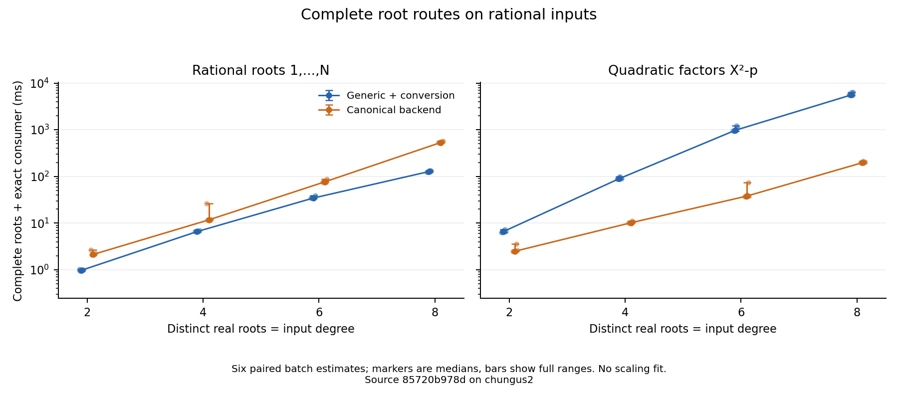
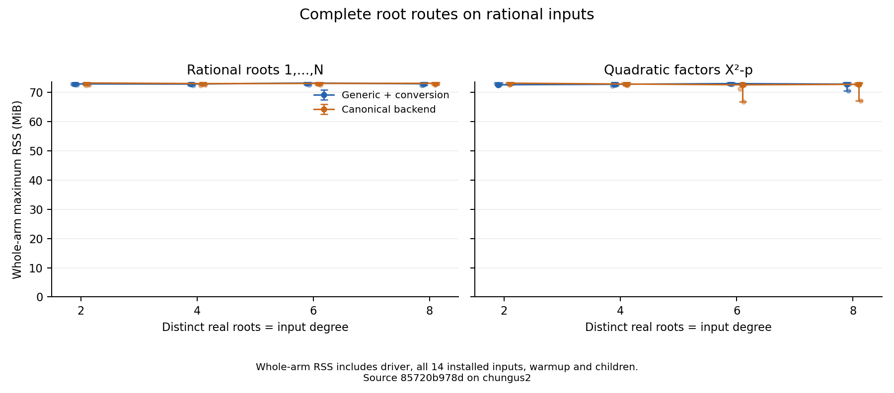

# Complete root routes with growing root counts

On these fixed rational inputs, the generic tower route is faster for the
rational-root family and slower for the quadratic-root family. At eight roots,
its median complete-call cost is 127.5 ms versus 533.1 ms for the canonical
backend on `∏(X-i)`, and 5577.2 ms versus 198.2 ms on
`(X²-2)(X²-3)(X²-5)(X²-7)`. These are descriptive observations on the shared
host, with no fitted scaling law or significance claim.

Both arms run the complete public root operation and the same exact consumer:
root count, multiplicity one, adjacent ordering, prescribed rational values or
quadratic signs/squares. The generic arm is `Trivial.Rational.roots`, including
conversion of every returned native root to a canonical algebraic real; the
canonical arm is `RealAlgebraicPoly.roots`. Coefficient lifting and preparation
are outside the timed batch. Independent python-flint 0.9 / FLINT 3.6 checks
all sixteen functional records by reconstructing their canonical roots and
factoring the original inputs. This is a rational-coefficient comparison;
selected algebraic coefficients and arbitrary towers remain outside its scope.

## Timing observations

Each cell is the median and full range of six retained per-call batch estimates
in milliseconds. Ratios and differences are computed within each adjacent
pair, then summarized; the ratio median is not the ratio of the marginal medians.
`N` is both input degree and distinct real-root count.

| Case | Generic ms [range] | Canonical ms [range] | Paired generic/canonical [range] | Paired generic − canonical ms [range] |
| --- | ---: | ---: | ---: | ---: |
| Rational2 | 0.973 [0.949, 1.014] | 2.125 [2.101, 2.703] | 0.451 [0.375, 0.468] | -1.166 [-1.689, -1.124] |
| Rational4 | 6.606 [6.559, 6.966] | 11.739 [11.622, 26.497] | 0.562 [0.252, 0.582] | -5.127 [-19.824, -4.995] |
| Rational6 | 34.384 [33.915, 39.426] | 76.565 [75.917, 88.205] | 0.449 [0.444, 0.452] | -42.180 [-48.779, -41.767] |
| Rational8 | 127.510 [122.944, 133.512] | 533.075 [518.222, 572.994] | 0.235 [0.228, 0.256] | -408.796 [-442.368, -385.666] |
| Quadratic2 | 6.596 [6.313, 7.247] | 2.500 [2.483, 3.628] | 2.554 [1.997, 2.672] | 3.969 [3.618, 4.170] |
| Quadratic4 | 89.926 [87.872, 100.615] | 10.179 [10.028, 11.163] | 8.813 [8.513, 9.761] | 79.570 [77.844, 90.307] |
| Quadratic6 | 975.010 [924.082, 1224.055] | 37.970 [36.689, 74.028] | 24.986 [16.535, 29.431] | 936.380 [886.671, 1150.027] |
| Quadratic8 | 5577.245 [5446.655, 6402.381] | 198.243 [195.268, 214.328] | 28.298 [27.793, 31.078] | 5379.001 [5250.684, 6188.053] |



The markers show medians, the faint dots show every batch, and bars show full
ranges. The logarithmic time axis does not imply a fitted complexity model.
The larger canonical outliers at Rational4 and Quadratic6 remain in the data.
All 96 raw batches, inner repeat counts and paired values are in
[analysis.json](analysis.json).

## Inputs and memory scope

Coefficient bits are the largest integer coefficient bit length. Native
point/selected counts come from an untimed execution of `Roots.roots`; they
are observed branch counts, rather than an external prediction of the finite
bisection policy. Both arms' functional records retain the same counts.

| Case | Degree / roots | Coefficient bits | Native points / selected | Generic maximum RSS KiB [range] | Canonical maximum RSS KiB [range] |
| --- | ---: | ---: | ---: | ---: | ---: |
| Rational2 | 2 | 2 | 1 / 1 | 74690.000 [74360.000, 75072.000] | 75022.000 [74256.000, 75324.000] |
| Rational4 | 4 | 6 | 2 / 2 | 74642.000 [74164.000, 75072.000] | 74802.000 [74136.000, 75240.000] |
| Rational6 | 6 | 11 | 3 / 3 | 74996.000 [74336.000, 75260.000] | 74864.000 [74288.000, 75264.000] |
| Rational8 | 8 | 17 | 4 / 4 | 74728.000 [74140.000, 75160.000] | 74908.000 [74396.000, 75148.000] |
| Quadratic2 | 2 | 2 | 0 / 2 | 74384.000 [74280.000, 75096.000] | 74954.000 [74324.000, 75236.000] |
| Quadratic4 | 4 | 3 | 0 / 4 | 74560.000 [74096.000, 75220.000] | 74650.000 [74144.000, 75268.000] |
| Quadratic6 | 6 | 5 | 0 / 6 | 74806.000 [74536.000, 75076.000] | 74376.000 [68508.000, 74892.000] |
| Quadratic8 | 8 | 8 | 0 / 8 | 74614.000 [72328.000, 75176.000] | 74540.000 [68856.000, 75048.000] |



GNU time measures the whole arm, including the driver, all fourteen installed
inputs, warmup, calibration and benchmark children. Its maximum RSS is a
process/child high-water measure, not simultaneous aggregate memory or
operation-exclusive allocation. Similar values here do not establish equal
allocation costs or memory complexity. Raw records also retain user/system CPU
time, elapsed time and exit status.

## Capture and reproduction

The [frozen protocol](protocol.md) predates timing at clean source
`85720b978d54bf92dfa47cb262b3639fc88da040`, retained by tag
`measurements/10378/distinct-85720b978d`. The runner used six trial-major rounds,
eight cases in registered order, adjacent generic/canonical arms alternating
AB/BA between rounds, `--repeats 1 --min-total-seconds 0.5`, 120-second per-call
and 3600-second process safeguards. All 96 arms completed in one capture; no
completed sample was discarded and no timing capture was repeated.

The host was `chungus2`, Linux x86_64, with automatically leased CPU 5. Host
load is retained as context. The enclosing experiment enforced 8 GiB aggregate
memory, zero swap and two Lean worker threads. The toolchain was
`leanprover/lean4:v4.35.0-rc3`, with clean pinned lean-bench
`8a37daf1074c3bdbd0da479b55538bad4a0022db`.
The explicit compiler wrapper used Clang and LLD. The driver C object was
rebuilt with that wrapper; its actual compile trace, generated C and object
hash are recorded. Dependencies may be cached, so this is not a fresh rebuild
of the full graph. The capture records compiler/tool versions, wrapper content,
link recipe, executable digest and selected source snapshots; the source tag
retains the complete implementation.

[capture.tar.gz](capture.tar.gz) contains all 415 indexed retained files except
the executable. [archive-index.json](archive-index.json) identifies every file,
Git source blob and the omitted executable's SHA-256 and size. The original
capture, including that executable, remains at the recorded local capture
path. The checked-in archive is sufficient to reproduce the analysis without
executing Lean or installing FLINT:

```sh
mkdir /tmp/hex-distinct
tar -xzf reports/bench-results/real-closure-distinct/capture.tar.gz -C /tmp/hex-distinct
python3 scripts/bench/analyze_real_closure_trivial.py /tmp/hex-distinct \
  --archive-index reports/bench-results/real-closure-distinct/archive-index.json \
  --output /tmp/hex-distinct-analysis.json
cmp /tmp/hex-distinct-analysis.json reports/bench-results/real-closure-distinct/analysis.json
```

A new collection uses a clean checkout of the measured tag, an explicit
`LEAN_CC`, GNU time and a Python environment with the pinned oracle packages:

```sh
python3 scripts/bench/collect_real_closure_trivial.py /absolute/new/capture \
  --suite distinct --oracle-python /absolute/oracle-env/bin/python3
```

The collector checks the benchmark driver's actual compiler trace, not only
the configured compiler path. If Lake reuses a driver object built by another
compiler, rebuild that derived object before collecting. Keep raw captures
outside the source checkout and use the project's experiment resource limits.
The default collector suite retains the earlier multiplicity comparison.

[figure-source.json](figure-source.json) records the analysis and plot-script
digests, command and rendering environment. [plot-requirements.txt](plot-requirements.txt)
pins the plotting environment. SVG and PDF versions accompany both PNGs.
Regenerate with:

```sh
python3 scripts/bench/plot_real_closure_trivial.py \
  reports/bench-results/real-closure-distinct/analysis.json /absolute/figure-output
```

## Coverage boundary

This extends the earlier [two-root multiplicity comparison](../real-closure-trivial/README.md)
with distinct-root growth, rational roots and squarefree degrees 2–8. It does
not complete selected algebraic-coefficient families, arbitrary extension
depth, outer isolation counters, certificate/evidence growth, the censored
canonical MetiTarski arm or the authoritative tower8 correction/archive. The
[Phase 4 coverage table](../../real-closure-phase4.md#measurement-coverage-and-remaining-work)
retains those independent obligations. Targeted diagnostic profiles explain
the unexpected family-dependent route costs separately from these timings.
