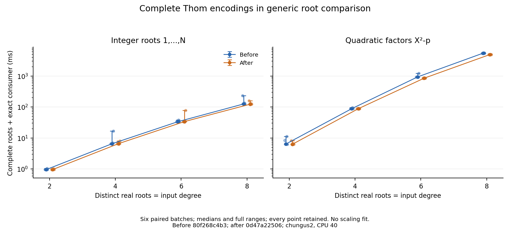
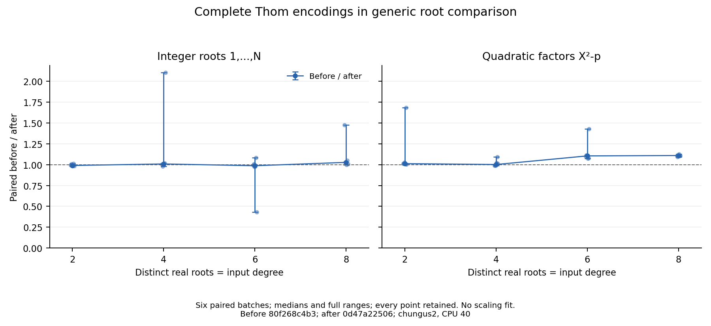

# Complete root comparison using full Thom encodings

Reusing the shared full-encoding comparison changes the median generic
complete-root cost on the eight-root quadratic input from 5491 ms to 4925 ms.
The six adjacent before/after ratios range from 1.093 to 1.126, median 1.109.
The rational cases and smaller quadratic cases have medians near one, with
some wide batch ranges. These are descriptive observations on the shared host,
without a significance or asymptotic claim. The six cases that cannot use the
new branch also show variation: all six Rational8 pairs and all six Quadratic2
pairs favor After, with ratio medians 1.027 and 1.012. This 1–3% shift may reflect
binary layout or host drift; the elapsed-time differences cannot be attributed
exclusively to avoided common-product comparisons.

`Isolation.Root.compare` first retains its existing monic-linear shortcut.
For other selected pairs, the new branch consumes `Descriptor.fullOrder` when
both stored heads agree and both derivative encodings are complete. Otherwise
the checked common-product comparison remains. The companion retains the
original total-order and accepted-equality theorem statements; their axiom
guards permit only `propext`, `Classical.choice` and `Quot.sound`. Original
root descriptors and payloads remain in the sorted output.

## Paired observations

Both frozen executables call the same registered `.generic` benchmark on
`∏_{i=1}^N (X-i)` and the first N/2 factors `X²-p`, for p=2,3,5,7. Each call
includes complete generic isolation, conversion of every native root to the
canonical carrier, and the same exact root-count, multiplicity, ordering and
value consumer. Preparation and coefficient lifting remain outside the timed
batch. Every functional root is independently checked by pinned FLINT.

Each table cell is the median [full range] of six retained estimates.
Differences and ratios are formed within adjacent pairs before summarizing.

| Case | Before ms | After ms | Paired before / after | Paired after − before ms |
| --- | ---: | ---: | ---: | ---: |
| Rational2 | 0.956 [0.947, 1.041] | 0.963 [0.952, 1.026] | 0.990 [0.983, 1.014] | 0.010 [-0.015, 0.016] |
| Rational4 | 6.520 [6.477, 16.828] | 6.586 [6.400, 7.992] | 1.008 [0.979, 2.105] | -0.053 [-8.835, 0.137] |
| Rational6 | 33.523 [32.909, 37.811] | 33.801 [33.333, 78.311] | 0.987 [0.432, 1.083] | 0.442 [-2.892, 44.516] |
| Rational8 | 125.398 [122.291, 233.560] | 123.196 [120.612, 158.129] | 1.027 [1.000, 1.477] | -3.319 [-75.431, -0.011] |
| Quadratic2 | 6.399 [6.299, 11.170] | 6.303 [6.266, 8.273] | 1.012 [1.001, 1.684] | -0.086 [-4.537, -0.007] |
| Quadratic4 | 88.184 [87.432, 95.708] | 88.057 [87.166, 88.589] | 1.001 [0.987, 1.094] | -0.127 [-8.222, 1.157] |
| Quadratic6 | 931.782 [911.905, 1224.165] | 849.107 [837.249, 857.971] | 1.105 [1.074, 1.427] | -88.497 [-366.194, -63.012] |
| Quadratic8 | 5491.277 [5356.035, 5515.318] | 4925.001 [4898.798, 4962.689] | 1.109 [1.093, 1.126] | -541.157 [-616.520, -454.221] |





The faint points show every batch; markers are medians and bars show full
ranges. Rational4's large positive ratio and Rational6's ratio below one
remain visible and retained. [analysis.json](analysis.json) contains all 96
raw estimates, inner repeats, configurations, child RSS and paired values.
Child RSS includes the entire measuring process, rather than exclusive
allocation by the root operation.

## Descriptor applicability

The [untimed descriptor inventory](selection.jsonl) uses the same registered
inputs. Singleton bisection cells intentionally store empty derivative words
(`Isolation.completeCell`); unresolved cells request every derivative. The
new direct comparison applies only to the latter complete encodings. The
earlier profile's large inclusive comparison/reencoding share therefore
does not identify how much work this guarded change can avoid.

| Case | Input degree / real roots | Coefficient bits | Native points / selected | Complete encodings | Full comparison applies / all unordered selected pairs |
| --- | ---: | ---: | ---: | ---: | ---: |
| Rational2 | 2 | 2 | 1 / 1 | 0 | 0 / 0 |
| Rational4 | 4 | 6 | 2 / 2 | 0 | 0 / 1 |
| Rational6 | 6 | 11 | 3 / 3 | 0 | 0 / 3 |
| Rational8 | 8 | 17 | 4 / 4 | 0 | 0 / 6 |
| Quadratic2 | 2 | 2 | 0 / 2 | 0 | 0 / 1 |
| Quadratic4 | 4 | 3 | 0 / 4 | 0 | 0 / 6 |
| Quadratic6 | 6 | 5 | 0 / 6 | 2 | 1 / 15 |
| Quadratic8 | 8 | 8 | 0 / 8 | 4 | 6 / 28 |

In these rational cases no selected pair has complete encodings. Four of the
eight quadratic descriptors have complete encodings, giving six applicable
pairs among 28 possible selected pairs. This descriptor inventory does not
measure sorter coverage. The later [outer-sort replay](sort.jsonl) starts from the actual
`Roots.assemble` input, calls the actual comparator at every insertion, and
checks its complete output index sequence against `Root.sortBy`:

| Case | All outer comparisons | Point/point | Mixed | Linear | Full Thom | Common-product |
| --- | ---: | ---: | ---: | ---: | ---: | ---: |
| Rational2 | 1 | 0 | 1 | 0 | 0 | 0 |
| Rational4 | 6 | 1 | 4 | 0 | 0 | 1 |
| Rational6 | 12 | 1 | 8 | 0 | 0 | 3 |
| Rational8 | 23 | 4 | 13 | 0 | 0 | 6 |
| Quadratic2 | 1 | 0 | 0 | 0 | 0 | 1 |
| Quadratic4 | 6 | 0 | 0 | 0 | 0 | 6 |
| Quadratic6 | 14 | 0 | 0 | 0 | 1 | 13 |
| Quadratic8 | 25 | 0 | 0 | 0 | 3 | 22 |

The assembly input is not already sorted; replaying a sorted result would give
a different comparison count. Quadratic8 takes the full-word route three times
among 25 outer comparisons, and Quadratic6 once among 14. Route labels are
classified from the comparator's guards; the order at each event comes from
the actual comparator. These are untimed replay counts, not instrumentation of the frozen timed executions or counts
of internal comparisons made by canonical conversion. The independent Python
inventory checker validates all event indices, routes and orders against the
production output ranks, and cross-checks every selected descriptor against the
earlier inventory. Its tests reject omitted/altered comparisons, lost indices,
changed artifact hashes, mismatched source blobs, altered complete stdout and
changed earlier descriptors even when their file hashes are updated.

The Quadratic6 paired median saving of 88.5 ms exceeds its total Before median
divided by 14 comparisons (66.6 ms). Uniform comparison costs therefore cannot
explain these aggregate observations. Individual comparison costs and the
fraction of the difference caused by other execution effects are unmeasured.
Rational8 and Quadratic4 also pay the extra full-word guard on six fallback
comparisons each; their observed shifts reinforce the attribution limit.

Partial encodings retain the common-product comparison. The unchanged canonical
conversion also remains in the measured operation; inclusive profile shares
cannot be subtracted to predict an exclusive stage speedup.

The inventory is deterministic native execution data, not an external
prediction of the bisection policy. `emit-selection` reads the benchmark's
existing prepared inputs and prints raw heads, derivative indices and signs.
[selection-source.json](selection-source.json) records its source `89c1d0029d`,
executable digest and output hashes. The complete resource-limited launcher
stdout/stderr accompany it. The optional diagnostic was added after the paired
capture; it leaves the registered inputs, measured functions and consumer
unchanged. The timing source remains the frozen tag below.
[sort-source.json](sort-source.json) binds the later replay to source
`5408295214a3fea3a3b6d47525b9f8aeba59ff09` (tag
`measurements/10378/thom-sort-5408295214`), the executable retained outside Git
at `/home/kim/.codex/tasks/hex-10378/sort-diagnostic-v1/`, complete launcher
streams and a Git-blob-checked benchmark snapshot. Its analysis is
[sort-analysis.json](sort-analysis.json). Both inventories are checked by the
focused Python tests; regenerating them is separate from timing collection.
The snapshot binds this historical diagnostic to its source tag, rather than
requiring future benchmark source to remain unchanged. The earlier selection
metadata names a mutable relative build path rather than a frozen executable
path. Its recorded digest is identity metadata; later builds may replace that
path.

## Frozen sources and compilation

The [protocol](protocol.md) was committed and pushed before timing. Before
source is `80f268c4b350f590f1a9ee3db7f584104c8a99d0`, retained by tag
`measurements/10378/thom-order-before-80f268c4b3`. After source and collection
tooling are `0d47a22506d4a70d760a9edb081d4288433a6173`, retained by tag
`measurements/10378/thom-order-0d47a22506`. The collector checks clean sources
before and after collection. Across all Lean sources, toolchain and package
manifest, only the comparator, its functional tests, its correspondence proof
and its axiom guards differ. The only computational library change is the
guarded shared Thom comparison. The delivered branch rebases those sources onto
main and adds later untimed inventories, functional checks and reporting.
The comparator and inlined Trivial generated C remained byte-identical to the
frozen After C after the rebase; the benchmark driver changes for diagnostics
are outside the paired timing source. The checked C hashes are
`9c6128d33c6911c89b619016b50d8e1cf96a9c2ccc84f840d47f5d431ec270d6`
for RootOrder and
`c0cbd672a4bc7beba39db731fde2816b769d015750a9ed71df85b0812a0e952d`
for Trivial.

Both arms use the same explicit Clang/LLD wrapper and pinned Lean
`v4.35.0-rc3` / lean-bench `8a37daf1074c3bdbd0da479b55538bad4a0022db`.
The freeze records compiler/tool versions, generated C, actual C-object traces,
object and executable hashes, link recipes, selected source snapshots and
exact Git blobs. Dependencies are cached; this is not a fresh build of every
dependency. The baseline comparator and Trivial objects were explicitly
rebuilt with the wrapper before freezing. Its binary still matches the
previously retained baseline SHA-256 `0db09da465ff0c79f637581955f2148b71f985271e7549bbe9f69ee25f9df1de`.
The changed binary is `ddfaf16da8eaba53937c9641eb11da9fdbe0889acb51516353e7dd76e00aec8e`.

The complete linked-object lists contain 377 objects. Objects with identical
generated C are byte-identical between arms. Only RootOrder and the inlined
callers Trivial and TrivialMeasurements have changed generated C, and those
three objects have matching compiler commands after normalizing source paths.
This checks compiler propagation beyond merely recording a configured
`LEAN_CC` value.

## Collection and reproduction

The run used six trial-major blocks, eight cases in registered family/size
order, adjacent Before/After arms alternating AB/BA, and
`--repeats 1 --min-total-seconds 0.5`. All 96 arms completed once; no completed
sample was discarded and no timing capture was repeated. Each returned the
complete consumer hash `0x1`. Registered per-call and process safeguards are
120 and 3600 seconds, with panic abort enabled.

The shared host was chungus2, AMD EPYC 9455 48-Core Processor, with automatically
leased CPU 40. One-minute loads before arms ranged from 5.386 to 37.847,
median 15.012. Affinity and per-command loads are retained. Collection ran under
the 8 GiB aggregate/no-swap experiment limit with two Lean worker threads;
its enclosing runtime was 9 min 9.434 s and memory peak 333 MiB. These are
operational context, not scientific timing budgets or isolated-host claims.

[capture.tar.gz](capture.tar.gz) retains all 268 capture files.
[archive-index.json](archive-index.json) binds every file and both external
executable identities. The original frozen executable directories remain at
the recorded local paths. The archive contains the source/preparation records
needed to audit and reproduce the analysis; executables remain outside Git.

```sh
mkdir /tmp/hex-thom-order
tar -xzf reports/bench-results/real-closure-thom-order/capture.tar.gz -C /tmp/hex-thom-order
python3 scripts/bench/analyze_real_closure_order.py /tmp/hex-thom-order \
  --archive-index reports/bench-results/real-closure-thom-order/archive-index.json \
  --output /tmp/hex-thom-order-analysis.json
cmp /tmp/hex-thom-order-analysis.json reports/bench-results/real-closure-thom-order/analysis.json
```

For a fresh comparison, use clean Before and After worktrees at the two frozen
source tags and run the After tag's tooling. Set the same explicit `LEAN_CC`,
use the project resource-limited launcher and pinned oracle environment, then:

```sh
python3 scripts/bench/freeze_real_closure_order.py --source /absolute/before-worktree \
  --output /absolute/new-before-frozen --oracle-python /absolute/oracle-env/bin/python3
python3 scripts/bench/freeze_real_closure_order.py --source /absolute/after-worktree \
  --output /absolute/new-after-frozen --oracle-python /absolute/oracle-env/bin/python3
python3 scripts/bench/fixed_conversion_paired.py --tower-order-only \
  --before /absolute/new-before-frozen --after /absolute/new-after-frozen \
  --output /absolute/new-paired-capture
```

The freeze verifies actual compiler traces for all three changed C modules.
A cached object made by another compiler must be rebuilt before freezing.
The collector enforces the registered source differences; the later optional
inventory addition is outside those frozen comparison tags. Existing collector
modes retain their original operation families, four blocks and 50 ms floor.

[figure-source.json](figure-source.json) binds the plot script, analysis,
rendering environment and PNG/SVG/PDF outputs. The plotting dependencies are
pinned by the [shared requirements](../real-closure-distinct/plot-requirements.txt).
Regenerate with `scripts/bench/plot_real_closure_order.py ANALYSIS OUTPUT`.

This supplies a measured component improvement and a guarded reuse proof.
The many remaining same-head fallback comparisons motivate investigating the
existing shared `Descriptor.buildOrder`, or completing each descriptor once
before sorting. Ordering disjoint retained intervals is another possible
shortcut. Neither change is part of these frozen measurements.

The [Phase 4 coverage table](../../real-closure-phase4.md#measurement-coverage-and-remaining-work)
retains the independent degree/root-count axis, nonreal and nondyadic rational
roots, selected algebraic coefficients, arbitrary tower depth, operation and
evidence-growth counters, archived workloads and tower8 correction. General
joint realization and successful multilevel native reconstruction also remain
with #10378.
