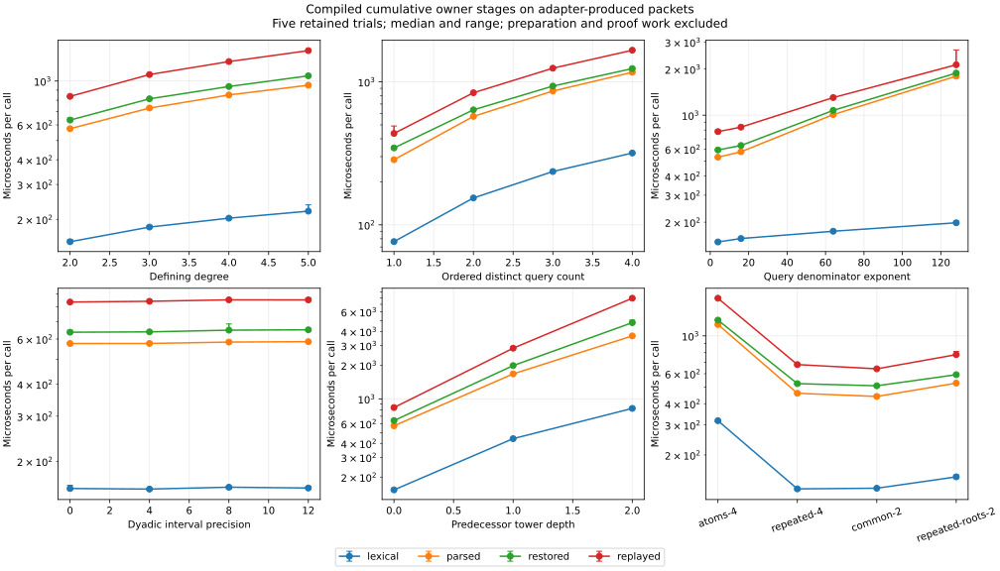

# Compiled selected-source packet dimensions

The question is how cumulative lexical checking, parsing, default catalog reconstruction and selected-sign replay change with independently varied root-defining degree, ordered query count, query coefficient height, dyadic interval precision and algebraic predecessor depth. Inputs are produced by the optional adapter's `SourceBuild.buildOn` and the existing owner selected-sign producer. Generation, adapter preparation, reification, literal creation and proof construction are excluded from the timed calls.

The corpus has 22 packets. The five axes change one declared parameter at a time from degree 2, two queries, denominator exponent 16, interval precision 0 and predecessor depth 0. Degree uses X^d − 2; query coefficients use 1/(2^b + 1); dyadic enclosures narrow around the positive quadratic root. The depth family adjoins positive roots of X² − (2 + previous generator) after the initial X² − 2 root. Additional cases exercise repeated queries, common roots at the selected point and repeated roots in query polynomials. These are representative finite inputs, not a worst-case BKR family or full tactic-atom scaling after normalization.

The source work varies with actual wire bytes, integer operand sizes, matrix dimensions, graph entries and predecessor calls. `Codec.checkBytes` visits each byte at most once after its length check. `readGraph` visits every stored row node and checks child indices against its actual earlier prefix. `Dag.selectedSigns?` validates every stored entry, including unreachable entries, and checks the selected row. These node visits contain coefficient arithmetic and matrix/identity checks, not constant-cost work. Catalog restoration additionally reconstructs predecessor contexts and decodes their coefficients. The depth recurrence charges local work plus all predecessor work; neither nested signs nor arbitrary-width integers are unit costs. The recorded byte/bit/node inventories accompany representative time and memory observations, without fitting a timing model or asserting a polynomial bound in unrestricted tower depth.

All 22 packets pass the owner lexical/parser/catalog/selected-sign checks before collection. Separate controls reject incorrect claims, swapped query order, stale graph versions, cyclic children, swapped contexts, omitted support columns, inconsistent positive counts, inconsistent moment values and an unknown root kind. Byte/depth/zero-digit limits also reject. The corrected preflight attempts are retained: one initially assumed every packet contained a multi-digit integer, one count mutation accidentally preserved an existing zero, and one expected semantic rejection where intrinsic rank bounds instead produced a parser error. No production checker changed.

The compiled driver has 449 compiler-listed imports and no Mathlib. Timed functions read their input through IO.Ref and return a consumed Boolean hash; parsing/reconstruction/replay each parse once. Four cumulative stages are reported separately. Differences between their times are not exclusive-stage measurements. Reconstruction includes the default owner's native predecessor decoding/arithmetic; this is not strict production-free replay at arbitrary depth, full certificate coverage or full tactic timing. Row DAG metrics count only the selected-sign evidence, excluding descriptor/predecessor graphs.

| Cumulative operation, degree-2 baseline | Median (minimum–maximum) μs |
| --- | ---: |
| lexical | 154.12 (153.69–157.90) |
| parsed | 574.22 (569.53–579.80) |
| restored | 634.90 (630.36–650.82) |
| replayed | 836.56 (832.35–838.20) |

| Independently varied axis | Endpoint packets | Bytes | Replay median μs | Maximum wire integer bits |
| --- | --- | ---: | ---: | ---: |
| Degree | degree-2 → degree-5 | 9,916 → 14,259 | 836.56 → 1424.63 | 68 → 203 |
| Distinct queries | atoms-1 → atoms-4 | 4,899 → 20,269 | 435.51 → 1662.63 | 66 → 72 |
| Query denominator exponent | bits-4 → bits-128 | 9,572 → 13,230 | 780.55 → 2134.56 | 20 → 516 |
| Dyadic precision | precision-0 → precision-12 | 9,916 → 10,046 | 836.53 → 852.88 | 68 → 68 |
| Predecessor depth | depth-0 → depth-2 | 9,916 → 53,744 | 836.08 → 7931.81 | 68 → 272 |

| Additional input | Bytes | Unique/expanded row nodes | Replay median (minimum–maximum) μs |
| --- | ---: | ---: | ---: |
| atoms-4 | 20,269 | 7/7 | 1662.63 (1652.10–1671.15) |
| repeated-4 | 8,097 | 3/7 | 678.33 (668.72–680.44) |
| common-2 | 8,268 | 3/3 | 640.57 (639.37–642.68) |
| repeated-roots-2 | 9,613 | 3/3 | 776.01 (772.41–809.62) |

Each point is a median of five retained trials; error bars show their full range. The complete 88 case/stage summaries retain all five individual observations. Endpoint tables do not hide intermediate cases: every point and raw export is included. Repeated queries reduce the selected-row graph from seven nodes to three on this fixed input; the expanded reference count remains seven. This is a literal evidence-size observation, not a measurement of physical proof sharing or a general speedup.

Across the retained samples, benchmark-worker peak RSS is 59,648–71,308 KiB; whole CLI/descendant wait4 peak RSS is 438,408–448,976 KiB. These scopes include their respective harness/runtime overhead. The final collection log supplies the aggregate cgroup peak and successful exit.

The fixed schedule has five trial-major blocks over all 22 packets, with adjacent stage order reversed in alternating blocks. Each arm contributes one warmed outer sample, autotuned to at least 0.2 seconds. An automatically leased logical CPU provides placement, not isolation. Host load is retained as context; no completed sample is removed. Every expected result hash must match. The fixed 30 second per-call safeguard is operational, not a scientific time budget. No unchanged rerun has been performed.

Per-call times exclude process startup and preparation. Benchmark-worker peak RSS and whole CLI/descendant wait4 RSS are different scopes; neither measures exclusive operation memory and no subtraction is made. All own builds and collection use one serial 32 GiB/no-swap/two-thread unit. Existing rational-tactic results and the earlier single 2911-byte catalog packet are not used as matched comparisons. No speedup, complexity model or mathematical independence is claimed.

The Hex source is `46c6114a4fc18ace27ff8167b51866f89d1f0d23`, clean at collection. The automatically leased CPU is 38 on `chungus2`. The raw exporter identifies the separate external harness checkout; the collection context identifies Hex. The [immutable record](data/hexrcf-source-replay-dimensions/README.md), [context](data/hexrcf-source-replay-dimensions/context.json), [summary](data/hexrcf-source-replay-dimensions/summary.json) and [raw exports](data/hexrcf-source-replay-dimensions/samples.tar.gz) retain exact source/input/executable hashes, compiler imports, all completed observations and the preparation/control attempts. Run `python3 reports/data/hexrcf-source-replay-dimensions/verify.py` to check the historical record. No later source is timed by it.

Ordinary-kernel source authentication and bounded packet quotation remain separately evidenced in the [bounded-source](hexrcf-bounded-source.md) and [scalar-acceptance](hexrcf-scalar-acceptance.md) records. Compiled result hashes here are test results, not proof evidence.

This supplies numerical-source component evidence. It does not complete missing original-syntax/history discovery, automatic tactic integration, strict compiled-record coverage, overall algebraic completeness, joint realization or remaining API/manual/proof evidence for #10358.

The [manual supplement](data/hexrcf-source-replay-manual/README.md) binds the short documentation link to this study, the final complete-manual build/render and two inspected viewport captures. Its final source-file checks pass. Earlier successful build/render attempts with the paragraph in the oversized main chapter are retained as superseded; the final paragraph belongs to the existing quotation subchapter. The numerical source and measurement record are unchanged.
